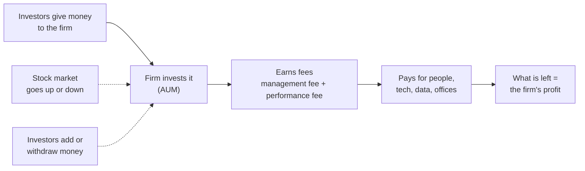
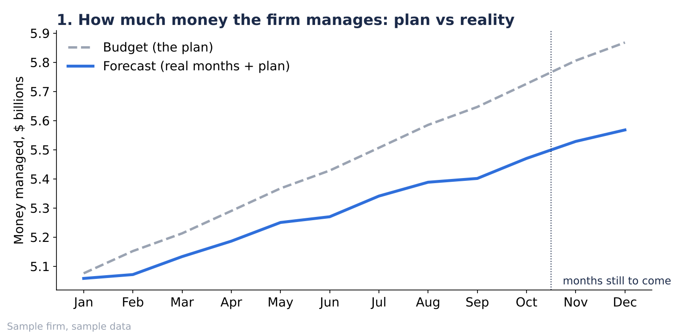
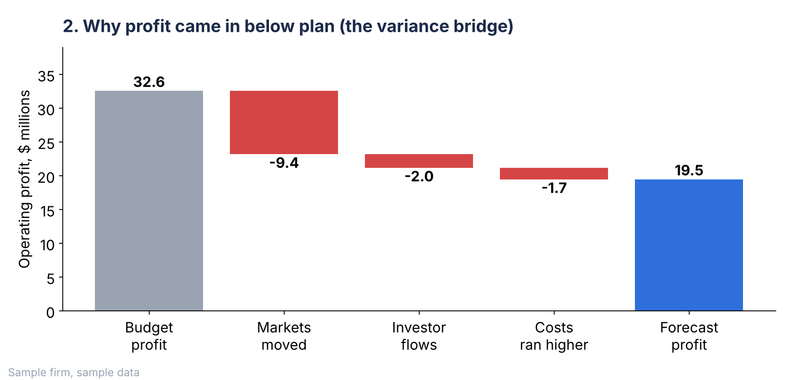
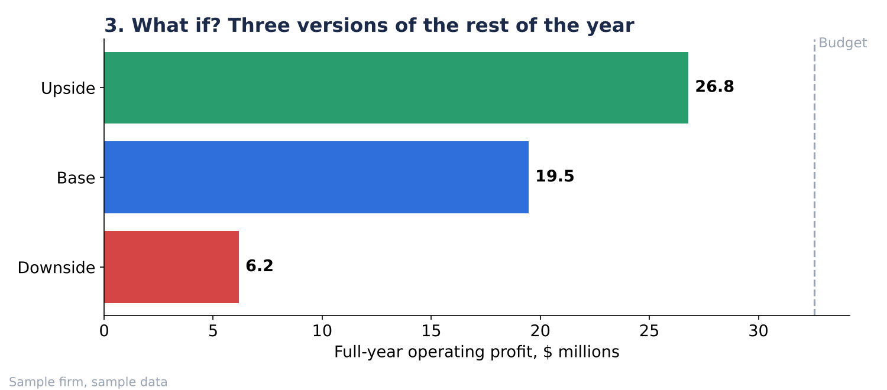
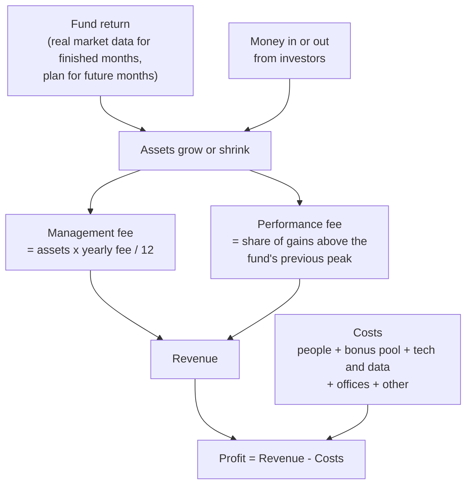

# FirmPulse

### How a hedge fund checks its own financial health, every month, with live market data.

**Live app: https://firmpulse-rho.vercel.app/**

> The firm in this project is a **sample** firm, and the charts below use **sample** numbers. It is not D. E. Shaw
> and says nothing about any real company's finances. The market data (S&P 500, VIX, interest rates) and the
> 13F holdings tab are real and public. Not investment advice. Not affiliated with any firm.

---

## 1. The idea, with no finance knowledge needed

Think of a hedge fund as a **business that looks after other people's money** and takes a cut.

- Investors hand the firm their money to invest. The total is called **assets under management (AUM)**.
- The firm charges a small yearly fee on that money, and a share of any profit it makes. Those are its **earnings**.
- The firm also **spends** money, mostly on people (researchers, engineers), plus technology, data and offices.
- **Earnings minus spending is the firm's own profit.**

The firm's finance team then has to answer one question over and over:

> **"How is our year going compared with the plan, why, and what happens if things change?"**

FirmPulse answers that question automatically, and updates it with real market data.



The two dotted arrows matter most. The firm does not control the stock market or whether investors stay, but both
change its profit a lot. That is why finance teams need a model, not just a spreadsheet of last month.

---

## 2. Four words you will see everywhere

| Word | Plain meaning | Example |
|---|---|---|
| **Budget** | The plan made before the year. | "We expect to make $32.6M profit." |
| **Forecast** | Best guess for the full year: real results for months already finished, plan for months still to come. | "Given what happened so far, we now expect $19.5M." |
| **Scenario** | A "what if" version of the rest of the year. | "What if markets fall 8% next month?" |
| **Variance** | The gap between forecast and budget, and the reasons for it. | "We are $13.1M short, mostly because markets fell." |

---

## 3. What FirmPulse shows you

### Money the firm manages: plan vs reality



The dashed line is the plan. The solid line is what really happened for finished months, then the plan's
assumptions for the rest. The gap opens because markets and investor flows came in below plan.

### Why did profit miss the plan? (the "variance bridge")



This is the heart of the project. It starts at the budgeted profit and walks to the forecast profit, naming each
cause in turn: **markets** moved, **investor flows** changed, and **costs** ran higher. The steps add up exactly to
the total gap, and the Excel file includes a cell that checks it.

### What if the rest of the year goes differently?



The **Base** case keeps the current path. **Upside** assumes better markets and more investor money. **Downside**
assumes a market shock and money leaving. Leaders use this to see how bad or good the year could get.

---

## 4. How the numbers are worked out

Every month, in this order:



**The "previous peak" rule (high-water mark).** A fund that loses money must win it back before it can charge a
performance fee again. So after a bad stretch, performance-fee income can fall to zero. FirmPulse models this
rule, which is why its profit can swing more than a simple "assets times a percentage" calculation.

**The variance bridge.** Start with the budget. Replace the planned market returns with the real ones and record
how much profit changed. Then do the same for investor flows, then for hiring and cost rates. Each step is one
cause, and together they explain the whole gap.

---

## 5. Where the data comes from

| Data | Source | What it is used for |
|---|---|---|
| S&P 500, VIX, T-bill rate, 10-year yield | **FRED** (Federal Reserve Bank of St. Louis) | Real market returns drive the finished months of the forecast. |
| D. E. Shaw's holdings | **SEC EDGAR, Form 13F** | The "Public 13F" tab. |
| Latest SPY price (optional) | Finnhub | A live quote card. |
| Commentary (optional) | Claude | Writes the variance explanation from the model's numbers. |

If no live data is available, the app shows a **SAMPLE** badge and uses built-in sample numbers. With live data
it shows **LIVE**.

### What is a 13F, and why is it here?

Every large US investment firm must tell the SEC, four times a year, which US-listed stocks and options it owned on
the last day of the quarter. That report is a **Form 13F**. It is the only public view into what a private firm
like D. E. Shaw actually holds.

FirmPulse reads D. E. Shaw's latest two filings and shows:

1. the biggest positions,
2. what changed since the previous quarter (what they bought and sold most),
3. how concentrated the portfolio is.

Two limits, stated on the page too: filings arrive up to **45 days late**, and they cover **only US-listed stocks
and options**, so they are a partial, delayed view of what the firm owns.

---

## 6. Why a hedge fund finance team would care

| What the finance team has to do | How FirmPulse does it |
|---|---|
| Set a plan and hold the firm to it | Budget locked, forecast updated against it |
| Explain a miss in plain language | Variance bridge plus written commentary |
| Prepare for good and bad markets | Base, Upside and Downside scenarios |
| Produce numbers leaders can trust | Excel workbook where every number is a live formula, checked against the code |
| Stop doing the same report by hand | Monthly report generated automatically |

## 7. What is inside

```
public/               The web app (one page, no build step) and a starter Excel workbook
api/                  Server routes: market data, model, commentary, 13F holdings, Excel export
lib/engine.py         The model: assets -> fees -> revenue -> costs -> profit
lib/market.py         Live market data from FRED, with a sample fallback
lib/sec13f.py         D. E. Shaw 13F download and parsing from SEC EDGAR
lib/commentary.py     Plain-English variance commentary
lib/xlsx_builder.py   Excel workbook where every number is a live formula
scripts/              Monthly variance report
tests/                32 automated checks (see below)
docs/                 The charts shown in this README
```

**Tech:** Python, vanilla JavaScript with hand-drawn SVG charts, openpyxl (Excel), FRED and SEC EDGAR APIs,
deployed on Vercel.

## 8. How it was checked

32 automated tests run the model and compare it with answers known to be right. The important ones:

- **Assets add up:** end-of-year assets = start + gains - fees + investor flows, to the cent.
- **The bridge adds up:** the cause-by-cause steps sum exactly to the total gap.
- **Excel matches the code:** the workbook is recalculated independently and agrees with the Python model to
  nine decimal places across four test cases and all three scenarios.
- **Bad input is rejected:** values sent from the browser are limited to sensible ranges.
- **Secrets stay private:** API keys and the SEC contact line never appear in any response.

## 9. Limits, and what comes next

- The firm is a sample, because a real firm's internal numbers are not public.
- Market data is end-of-day, and the 13F is partial and delayed.
- The model uses a single simplified fund.

Next steps: load real monthly actuals (money in and out, headcount, costs) from a file, add several funds, and
add an approval trail for changes to the plan.
